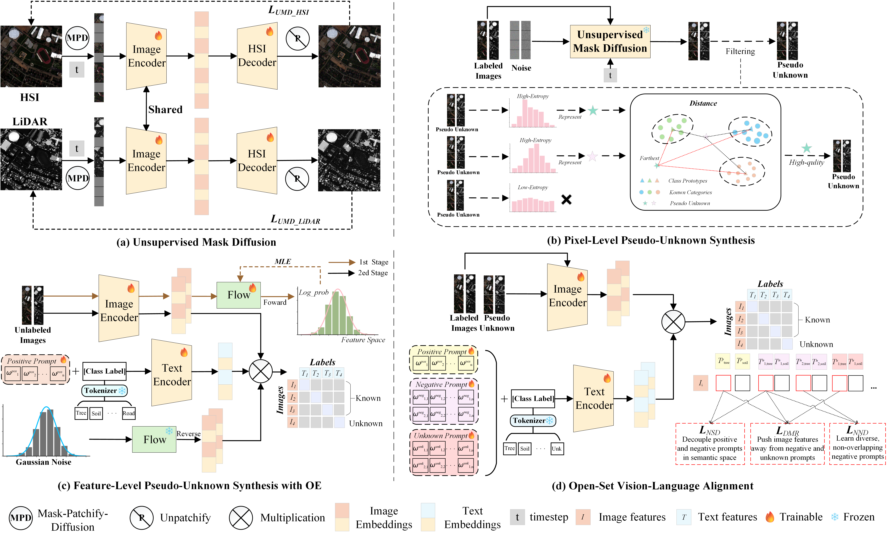

# OpenGPL: Multimodal Open-Set Recognition via Dual-Level Pseudo-Unknown Generation and Positive-Negative Prompt Learning, TGRS, 2026.

[Yile Li](https://ieeexplore.ieee.org/author/37089507735), [Bobo Xi](https://b-xi.github.io/), [Wenjie Zhang](https://wenj-zhang.github.io/), [Yufei He](https://orcid.org/0009-0004-4938-6773), [Jiaojiao Li](https://scholar.google.com/citations?user=Ccu3-acAAAAJ&hl=zh-CN&oi=sra), [Ming Shen](https://vbn.aau.dk/en/persons/mish/), [Yunsong Li](https://dblp.org/pid/87/5840.html).

---

Code for the paper: [OpenGPL: Multimodal Open-Set Recognition via Dual-Level Pseudo-Unknown Generation and Positive-Negative Prompt Learning](https://doi.org/10.1109/TGRS.2026.3724864).



Fig. 1: The architecture of the proposed OpenGPL for multimodal open-set recognition.

## Abstract

The multimodal fusion of hyperspectral image (HSI) and light detection and ranging (LiDAR) data has advanced remote sensing classification. However, existing methods are mainly based on the closed-set assumption and are thus less effective in real-world open-set scenarios where unknown categories may appear during inference, due to the lack of representative unknown samples and the semantic gap across modalities. To address this, we propose OpenGPL, a novel multimodal open-set recognition (OSR) framework that integrates contrastive language-image pre-training (CLIP) with generative models. First, to tackle the problem of missing unknown samples, we propose a dual-level pseudo-unknown generation strategy. At the pixel level, we employ a diffusion model with a multi-metric filtering mechanism to synthesize high-quality pseudo-unknown samples. At the feature level, we introduce a normalizing flow to sample features near the decision boundary, thereby tightening the feature distribution of known classes via an outlier exposure (OE)-inspired strategy.Second, to bridge the multimodal semantic gap, we design a positive--negative prompt learning mechanism. By maximizing the similarity between features and positive prompts while pushing them away from negative prompts, this scheme explicitly constructs a more discriminative semantic space, effectively enlarging the boundary between known and unknown categories. Finally, we adopt a dual-verification mechanism that fuses energy scores with similarities to negative prompts to accurately reject unknown classes. Comprehensive experiments conducted on three benchmark HSI-LiDAR datasets demonstrate that the OpenGPL achieves competitive performance in recognizing known classes and detecting unknown categories in open-set scenarios.

## Training and Test Process

1. Download the datasets from [Google Drive](https://drive.google.com/drive/folders/1wKdbB6WupjPCdXOnZ-YpbqJMrXSopJAu?usp=sharing).
2. Place `Houston2013`, `Muufl`, and `Augsburg` folders under the project root.
3. Set the experiment parameters in `config.py` and run `train.py`:

```bash
python train.py --dataset 2013houston
python train.py --dataset Muufl
python train.py --dataset Augsburg
```

## References

If you find this code helpful, please kindly cite:

[1] Y. Li, B. Xi, W. Zhang, Y. He, J. Li, M. Shen, and Y. Li, "OpenGPL: Multimodal Open-Set Recognition via Dual-Level Pseudo-Unknown Generation and Positive-Negative Prompt Learning," in *IEEE Transactions on Geoscience and Remote Sensing*, vol. 64, Art. no. 5525114, 2026, doi: [10.1109/TGRS.2026.3724864](https://doi.org/10.1109/TGRS.2026.3724864).

## Citation Details

BibTeX entry:

```bibtex
@ARTICLE{TGRS_2026_OpenGPL,
  author={Li, Yile and Xi, Bobo and Zhang, Wenjie and He, Yufei and Li, Jiaojiao and Shen, Ming and Li, Yunsong},
  journal={IEEE Transactions on Geoscience and Remote Sensing},
  title={OpenGPL: Multimodal Open-Set Recognition via Dual-Level Pseudo-Unknown Generation and Positive-Negative Prompt Learning},
  year={2026},
  volume={64},
  note={Article 5525114},
  doi={10.1109/TGRS.2026.3724864}
}
```
